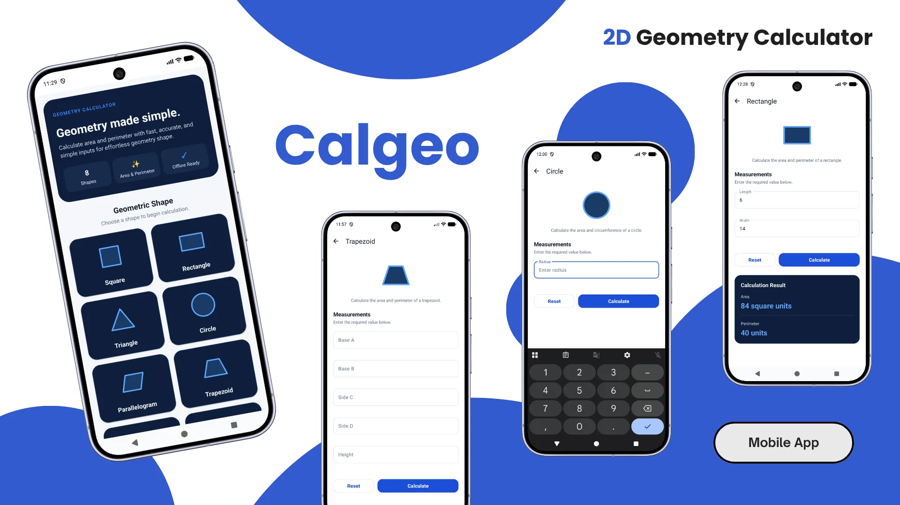
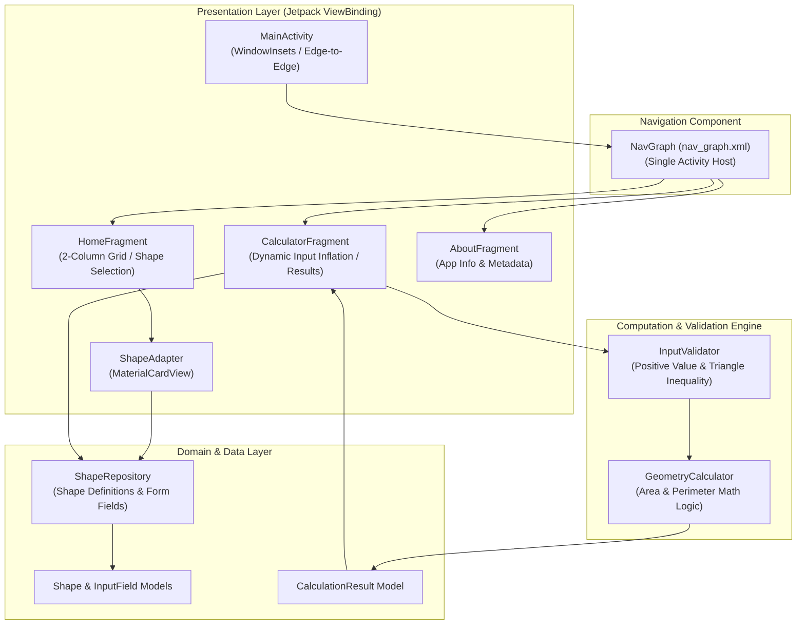
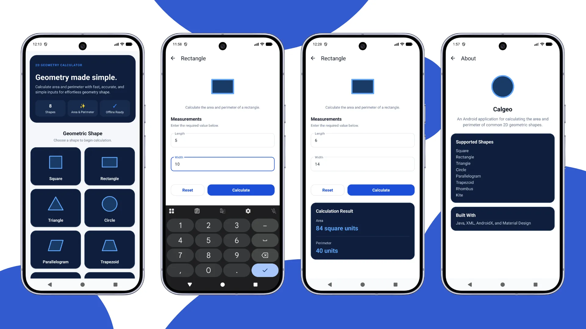

# Calgeo - 2D Geometry Calculator




## Project Overview

Calgeo is a native Android calculation utility engineered to compute the geometric area, perimeter, and circumference of common two-dimensional shapes. Designed to replace manual formula lookups and prone-to-error arithmetic, the application delivers instantaneous floating-point precision through dynamic layout inflation and strict mathematical constraint verification. Developed specifically for students, educators, and technical practitioners, Calgeo functions entirely offline on modern Android devices with an edge-to-edge Material Design interface.

## Key Features

- **Comprehensive 2D Shape Suite**: Supports eight fundamental planar geometries: Square, Rectangle, Triangle, Circle, Parallelogram, Trapezoid, Rhombus, and Kite.
- **Dynamic Form Inflation**: Programmatically generates customized measurement input fields based on the selected geometric shape without requiring static form clutter.
- **Rigorous Geometric Validation**: Enforces positive numeric constraints and evaluates mathematical feasibility, including triangle inequality theorem compliance ($a+b > c$).
- **Dual Metric Computation**: Simultaneously calculates and displays both two-dimensional area (in square units) and boundary perimeter or circumference (in linear units).
- **Edge-to-Edge System UI Integration**: Adapts dynamically to system window insets, notch cutouts, status bars, and gesture navigation bars using `WindowInsetsCompat`.
- **Zero-Permission Offline Utility**: Runs entirely standalone without requesting network access, background services, device sensors, or persistent storage permissions.

## Supported Platforms

| Platform | Operating System | Minimum Version | Support / Test Status |
| --- | --- | --- | --- |
| Mobile Device | Android | Android 8.0 (API level 26, Oreo) | Supported & Configured |
| Mobile Device (Target) | Android | Android 16 (API level 36) | Targeted & Verified |
| Tablet / Foldable | Android | Android 8.0 (API level 26, Oreo) | Supported via Responsive Grid |

## Tech Stack

| Category | Technology | Purpose |
| --- | --- | --- |
| Primary Language | Java 17 | Core application programming language and utility business logic |
| Mobile Platform | Android SDK (compileSdk 37) | Native Android operating system APIs and runtime framework |
| UI Framework | Android Jetpack ViewBinding | Null-safe view referencing and dynamic input layout inflation |
| UI Toolkit | Material Components 1.14.0 | Design system widgets, Material cards, and input layout styles |
| Navigation | Navigation Component 2.10.0 | Single-activity host navigation and fragment transaction management |
| Layout Engine | ConstraintLayout 2.2.2 | Flexible, responsive layout management across varied screen densities |
| List & Grid Component | RecyclerView 1.4.0 | High-performance 2-column geometric shape catalog presentation |
| Build System | Gradle 9.5.0 / AGP 9.3.2 | Automated project dependency resolution and build orchestration |
| Unit Testing | JUnit 4.13.2 | Host-side JVM local unit testing framework |
| UI & Integration Testing | Espresso 3.6.1 / AndroidX JUnit 1.2.1 | On-device instrumentation and automated UI interaction testing |

## Application Architecture

Calgeo is built on clean Android architectural principles utilizing a single-activity architecture powered by the Android Jetpack Navigation Component. `MainActivity` establishes an edge-to-edge window configuration with `WindowCompat` and intercepts window insets to provide consistent safe padding across devices. User interactions flow from `HomeFragment`, where geometric shapes are rendered using a 2-column `RecyclerView` and `ShapeAdapter`, into `CalculatorFragment` via type-safe bundle navigation. Dynamic measurement forms are programmatically instantiated from `ShapeRepository`. When calculation is triggered, inputs pass through `InputValidator` for numeric integrity and geometric feasibility checks before being processed by `GeometryCalculator`, ensuring pure separation between the Android presentation layer and mathematical evaluation logic.



## Screenshots / Preview

### 1. Shape Selection & Real-Time Geometry Computation Interface

The primary computational workspace of Calgeo, displaying dynamic measurement text fields, contextual input hints, and instant calculation cards that present both area in square units and perimeter in linear units with input reset options.

## Prerequisites

Before building or running the project, ensure your workstation meets the following requirements:

- **Operating System**: Windows 10/11 (64-bit), macOS 12 Monterey or later, or Linux (x86_64).
- **Java Development Kit (JDK)**: JDK 17 (LTS) configured in your system environment or Gradle toolchain.
- **Android Studio**: Android Studio Koala, Ladybug, or newer with Android SDK Command-line Tools installed.
- **Android SDK Platforms**: Android SDK Platform 36 and Android SDK Platform 37 installed via SDK Manager.
- **Physical Device or Android Emulator**: A device or Android Virtual Device (AVD) running Android 8.0 (API level 26) or higher.

## Installation & Setup

Follow these steps to clone the repository and build the project from source:

1. Clone the repository to your local development machine:
   ```bash
   git clone https://github.com/weztcy/Calgeo---2D-Geometry-Calculator.git
   cd "Calgeo---2D-Geometry-Calculator"
   ```

2. Open the project directory in Android Studio via **File > Open**.

3. Synchronize Gradle dependencies and verify that the Gradle build system completes indexing:
   ```bash
   ./gradlew --refresh-dependencies
   ```

4. Assemble the debug build artifact using the Gradle wrapper:
   ```bash
   ./gradlew assembleDebug
   ```

5. Deploy and install the application directly onto your connected Android device or running emulator:
   ```bash
   ./gradlew installDebug
   ```

## Application Configuration

The core runtime parameters, SDK targets, and build properties are declared within `app/build.gradle.kts` and `gradle.properties`:

| Configuration | Description | Default / Example |
| --- | --- | --- |
| `namespace` | Android application package identifier | `com.example.calgeo` |
| `applicationId` | Unique Android package identifier for deployment | `com.example.a2dshapecalculatormobileapp` |
| `minSdk` | Minimum Android API level required to execute the app | `26` (Android 8.0 Oreo) |
| `targetSdk` | Target Android API level optimized for execution | `36` (Android 16) |
| `compileSdk` | Compilation SDK version against Android system headers | `37` |
| `sourceCompatibility` | Java language compiler version target | `JavaVersion.VERSION_17` |
| `viewBinding` | Android Jetpack ViewBinding build feature flag | `true` |
| `isMinifyEnabled` | Code shrinking and obfuscation setting for release builds | `false` |

## Testing

Calgeo incorporates local JVM unit tests and Android on-device instrumentation test configurations:

- **Local Unit Testing**: Validates isolated geometric formulas, edge-case arithmetic, positive-number verifications, and triangle inequality enforcement in `GeometryCalculator` and `InputValidator`.
- **Instrumentation Testing**: Validates fragment navigation flows, dynamic layout inflation, and UI interaction states via AndroidX Test and Espresso.

Execute local unit tests on the host machine:
```bash
./gradlew test
```

Execute instrumentation tests on a connected emulator or test device:
```bash
./gradlew connectedAndroidTest
```

## Build & Packaging

To compile distribution packages (APK or Android App Bundle):

1. Generate the standalone debug APK:
   ```bash
   ./gradlew assembleDebug
   ```
   The compiled artifact is generated at:
   `app/build/outputs/apk/debug/app-debug.apk`

2. Generate an unsigned production release APK:
   ```bash
   ./gradlew assembleRelease
   ```
   The compiled artifact is generated at:
   `app/build/outputs/apk/release/app-release-unsigned.apk`

3. Generate an Android App Bundle (AAB) for optimized distribution:
   ```bash
   ./gradlew bundleRelease
   ```
   The output bundle is generated at:
   `app/build/outputs/bundle/release/app-release.aab`

## Usage

Calgeo provides an intuitive, friction-free calculation workflow:

1. **Launch the Application**: Open Calgeo from your Android launcher to view the home dashboard.
2. **Select a Geometric Shape**: Tap any shape card from the 2-column catalog (e.g., Square, Triangle, Circle, or Trapezoid).
3. **Enter Dimension Values**: Input the required measurement values into the dynamically generated fields (e.g., Base and Height for a Triangle, or Diagonal 1 and 2 for a Rhombus).
4. **Execute Calculation**: Tap the **Calculate** button. The application validates that all inputs are positive and structurally valid before computing results.
5. **Inspect or Reset Results**: View the computed Area and Perimeter or Circumference in the result cards, or tap the **Reset** button to clear all inputs and start a new calculation.

## Contributing

Contributions to Calgeo are welcome. To contribute enhancements or fixes, follow this workflow:

1. Fork the repository on GitHub.
2. Create a dedicated feature or bugfix branch:
   ```bash
   git checkout -b feature/geometric-enhancement
   ```
3. Implement your changes adhering to existing Java naming conventions and clean architecture boundaries.
4. Execute test suites to ensure zero regressions:
   ```bash
   ./gradlew test
   ```
5. Commit your changes with clear, descriptive commit messages:
   ```bash
   git commit -m "feat: add polygon geometric formula verification"
   ```
6. Push the branch to your fork and submit a Pull Request describing your changes in detail.

## License

This project is licensed under the MIT License.
See the [LICENSE](LICENSE) file for details.

## Author & Contact

**Yohanes Dimas Pratama**

- GitHub: [github.com/weztcy](https://github.com/weztcy)
- Portfolio: [yohanesdimas.com](https://yohanesdimas.com)
- LinkedIn: [linkedin.com/in/yohanes-dimas](https://www.linkedin.com/in/yohanes-dimas)
