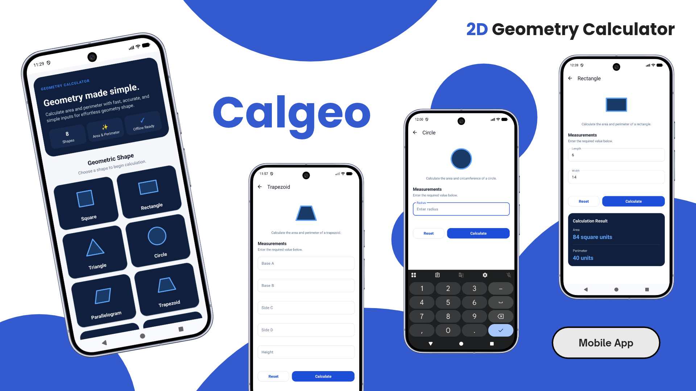

# Calgeo — 2D Geometry Calculator

[-brightgreen?logo=android&logoColor=white)](https://www.android.com/)
[](https://openjdk.org/)
[](https://m3.material.io/)
[](https://developer.android.com/guide/navigation)
[](https://gradle.org/)
[-success?logo=junit5&logoColor=white)](https://junit.org/)
[](#permissions--device-requirements)
[](./LICENSE)

<p align="center">
  
</p>

Calgeo is an offline-first native Android utility engineered to provide fast, precise, and intuitive geometric calculations for two-dimensional planar figures. Designed to replace error-prone manual calculations and cumbersome formula lookups, Calgeo delivers instant area, perimeter, and circumference evaluations across eight fundamental planar shapes: Square, Rectangle, Triangle, Circle, Parallelogram, Trapezoid, Rhombus, and Kite.

Engineered with modern Android development best practices, the application features a Single-Activity architecture powered by Android Jetpack Navigation Component, type-safe ViewBinding, and Google's Material Design 3 design system. Calgeo is developed in Java 17 and incorporates full Edge-to-Edge window inset handling, ensuring visual consistency across modern Android devices featuring display cutouts, notches, and gesture navigation bars. Guided by an absolute zero-permission philosophy, Calgeo operates 100% locally with zero internet connectivity requirements, zero disk storage persistence, and zero third-party telemetry, offering complete user privacy and an instant, battery-efficient calculation experience.

---

## Features

- **Comprehensive 2D Geometric Computations**:
  - **Square**: Calculates area ($A = s^2$) and perimeter ($P = 4s$) from a single side dimension.
  - **Rectangle**: Computes surface area ($A = l \times w$) and total perimeter ($P = 2(l + w)$) from length and width.
  - **Triangle**: Evaluates area ($A = \frac{1}{2} b h$) and perimeter ($P = b + \text{side}_B + \text{side}_C$), safeguarded by strict geometric validation via the Triangle Inequality Theorem.
  - **Circle**: Computes exact area ($A = \pi r^2$) and circumference ($C = 2 \pi r$) utilizing double-precision mathematical constants (`Math.PI`).
  - **Parallelogram**: Evaluates area ($A = b \times h$) and boundary perimeter ($P = 2(b + s)$) from base, side, and perpendicular height.
  - **Trapezoid**: Calculates area ($A = \frac{1}{2}(a + b)h$) and boundary perimeter ($P = a + b + c + d$) using distinct parallel bases, lateral legs, and perpendicular altitude.
  - **Rhombus**: Evaluates inner area ($A = \frac{1}{2} d_1 d_2$) and perimeter ($P = 4s$) using primary diagonals and congruent side length.
  - **Kite**: Evaluates planar area ($A = \frac{1}{2} d_1 d_2$) and perimeter ($P = 2(a + b)$) from orthogonal diagonals and two distinct pairs of adjacent congruent sides.
- **Dynamic Runtime Form Generation**:
  - Automatically builds and inflates shape-specific Material 3 `TextInputLayout` containers dynamically based on the chosen shape's mathematical parameters via `ShapeRepository`.
  - Configures optimal soft keyboard flows: intermediate inputs trigger `IME_ACTION_NEXT`, while the final parameter field configures `IME_ACTION_DONE` to dismiss the on-screen keyboard automatically.
  - Intelligent tap-to-dismiss behavior: tapping empty container areas or background surfaces releases active focus and hides the soft keyboard.
- **Strict Real-Time Input Validation & Geometric Integrity**:
  - Comprehensive parameter validation: detects and flags empty entries, invalid numeric formats, `NaN`, infinite values, and non-positive measurements ($\le 0$).
  - Triangle Inequality Theorem verification: validates that the sum of any two sides strictly exceeds the third side ($a + b > c$, $a + c > b$, and $b + c > a$) before executing area and perimeter calculations.
  - First-invalid field auto-focusing and smooth programmatic scrolling to instantly guide user attention to erroneous inputs.
  - Automatic error reset on touch, clearing error banners as soon as an input field receives focus.
- **Precision Formatting & Contextual Results**:
  - Clean floating-point output formatting using localized `NumberFormat` capped at two decimal places, automatically suppressing superfluous trailing zeros (e.g., displaying `25` instead of `25.00` and `12.5` instead of `12.50`).
  - Context-aware nomenclature: dynamically toggles metric headers between **Perimeter** and **Circumference** when Circle calculations are selected.
  - Smooth programmatic scroll to the results view container upon successful calculation.
- **Modern Edge-to-Edge System & Material 3 Styling**:
  - Full system window insets integration (`WindowCompat.setDecorFitsSystemWindows` and `ViewCompat.setOnApplyWindowInsetsListener`) applying protective padding against system status bars, navigation bars, and display cutouts.
  - Refined Material Design 3 styling utilizing tonal elevation, card containers, vector iconography, and high-contrast typography.
  - Single-activity architecture backed by Android Jetpack Navigation Component with safe argument passing via serializable bundles.

---

## Preview & Demo

### Interactive Application Workflow & Geometry Calculator Interface


_The central 2D geometry selection dashboard featuring the hero overview card, metric badges, and 2-column shape grid (Square, Rectangle, Triangle, Circle, Parallelogram, Trapezoid, Rhombus, Kite), followed by the dynamic calculation form showcasing contextual input fields, real-time validation, and formatted Area & Perimeter/Circumference output cards._

---

## Platform Support

| Dimension | Specification | Verification Source |
| :--- | :--- | :--- |
| **Target Operating System** | Android | Android Manifest & Gradle Build Configuration |
| **Minimum OS Version** | Android 8.0 (Oreo, API Level 26) | `minSdk = 26` in `app/build.gradle.kts` |
| **Target OS Version** | Android 15 (Vanilla Ice Cream, API Level 36) | `targetSdk = 36` in `app/build.gradle.kts` |
| **Compile SDK** | Android 15 / API Level 37 | `compileSdk = 37` in `app/build.gradle.kts` |
| **Supported CPU Architectures** | `arm64-v8a`, `armeabi-v7a`, `x86`, `x86_64` | Native Dalvik & Android Runtime (ART) |
| **Screen Form Factors** | Phones & Tablets (Portrait & Multi-Window) | ConstraintLayout & NestedScrollView layouts |
| **Tested Targets** | Android Emulators & Physical Hardware (API 26–36) | Verified local runtime verification and test runs |
| **Published Targets** | Pre-built Installable Debug APK | `app-debug.apk` compiled in local build outputs |

---

## Tech Stack

### Core Platform & Language

- **Programming Language**: Java 17 (`JavaVersion.VERSION_17` source & target compatibility)
- **Framework**: Native Android SDK (API Level 37 compileSdk, API Level 36 targetSdk)
- **Application Architecture**: Single-Activity Pattern with Android Jetpack Navigation Component

### Android Jetpack & UI Components

- **ViewBinding**: Android Gradle Plugin ViewBinding (`buildFeatures { viewBinding = true }`) for compile-time type-safe view lookups without synthetic overhead.
- **Navigation Component**: AndroidX Navigation (`androidx.navigation:navigation-fragment:2.10.0` and `navigation-ui:2.10.0`) for fragment transactions, deep linking, and bundle argument passing.
- **Material Design 3**: Google Material Components (`com.google.android.material:material:1.14.0`) for MaterialCardView, MaterialToolbar, TextInputLayout, TextInputEditText, and MaterialButton.
- **Layout Engines**: AndroidX ConstraintLayout (`androidx.constraintlayout:constraintlayout:2.2.2`), AndroidX RecyclerView (`androidx.recyclerview:recyclerview:1.4.0`) with 2-span GridLayoutManager, and NestedScrollView.
- **Edge-to-Edge System**: AndroidX Core (`androidx.core:core:1.19.0`) and AndroidX WindowCompat / ViewCompat for system window and display cutout inset handling.
- **Compatibility**: AndroidX AppCompat (`androidx.appcompat:appcompat:1.8.0`).

### Build System & Toolchain

- **Build System**: Gradle 9.5.0 (`gradle-9.5.0-bin.zip`).
- **Android Gradle Plugin (AGP)**: AGP 9.3.2.
- **Code Optimization & Obfuscation**: ProGuard / R8 (`proguard-android-optimize.txt`, `proguard-rules.pro`).

### Testing Framework

- **Unit Testing**: JUnit 4 (`junit:junit:4.13.2`).
- **Instrumentation & UI Testing**: AndroidX Test Ext JUnit (`androidx.test.ext:junit:1.2.1`) and Espresso Core (`androidx.test.espresso:espresso-core:3.6.1`).

---

## Prerequisites

### Developer Environment

- **Java Development Kit (JDK)**: JDK 17 (LTS) configured in your development environment or bundled within Android Studio.
- **Android Studio**: Android Studio Ladybug (2024.2.1) / Meerkat or newer recommended.
- **Android SDK**:
  - Android SDK Platform 36 / 37
  - Android SDK Build-Tools matching AGP 9.3.2
- **Emulator / Device**:
  - Android Virtual Device (AVD) running Android 8.0 (API Level 26) or higher.
  - Physical Android hardware with Developer Options and USB Debugging enabled.

### End-User Requirements

- An Android smartphone or tablet running **Android 8.0 (Oreo / API Level 26)** or higher.
- Approximately **10 MB** of free internal device storage for APK installation.

---

## Installation & Setup

### Developer Setup

1. **Clone the Repository**:
   ```bash
   git clone https://github.com/weztcy/Calgeo---2D-Geometry-Calculator.git
   cd "Calgeo - 2D Geometry Calculator"
   ```

2. **Configure Local Android SDK Location**:
   Create a `local.properties` file in the project root if it is not present, pointing to your local Android SDK directory:
   ```properties
   # Windows example:
   sdk.dir=C\:\\Users\\<YourUsername>\\AppData\\Local\\Android\\Sdk

   # macOS / Linux example:
   # sdk.dir=/Users/<YourUsername>/Library/Android/sdk
   ```

3. **Verify Dependencies & Project Sync**:
   Execute the Gradle wrapper to download dependencies and verify build toolchains:
   ```bash
   ./gradlew tasks
   ```

4. **Launch the Application**:
   Install and run the debug build onto your connected emulator or physical device:
   ```bash
   ./gradlew installDebug
   ```

### End-User Installation (Pre-built APK)

1. Locate the pre-compiled debug APK:
   - File Path: `app/build/outputs/apk/debug/app-debug.apk`
   - File Size: ~7.68 MB
2. Transfer `app-debug.apk` to your target Android device via USB transfer, local file sharing, or direct download.
3. Open your device's File Manager, tap `app-debug.apk`, and confirm the installation prompt (enable "Install from unknown sources" for your file manager if required).
4. Launch **2D Geometry Calculator** from your app drawer.

---

## Environment Variables & Configuration

Calgeo is a completely self-contained, 100% offline mathematical application. It requires **no external API keys, remote server endpoints, cloud services, or third-party authentication credentials**.

All build and runtime parameters are managed declaratively in the Gradle configuration:

| Configuration Item | File Location | Value | Description |
| :--- | :--- | :--- | :--- |
| `namespace` | `app/build.gradle.kts` | `com.example.calgeo` | Base Java package namespace |
| `applicationId` | `app/build.gradle.kts` | `com.example.a2dshapecalculatormobileapp` | Unique Android application ID |
| `minSdk` | `app/build.gradle.kts` | `26` | Minimum supported Android OS (Android 8.0 Oreo) |
| `targetSdk` | `app/build.gradle.kts` | `36` | Target Android OS version (Android 15) |
| `compileSdk` | `app/build.gradle.kts` | `37` | Compilation SDK version |
| `versionCode` | `app/build.gradle.kts` | `1` | Internal build version code |
| `versionName` | `app/build.gradle.kts` | `1.0` | User-facing application version name |
| `viewBinding` | `app/build.gradle.kts` | `true` | ViewBinding code generation flag |

---

## Usage / Getting Started

### 1. Shape Selection from Dashboard

- Upon launching Calgeo, the Home dashboard presents a hero overview card detailing supported capabilities alongside a two-column grid showcasing all 8 planar geometric shapes.
- Tap any geometric shape card (e.g., **Triangle**, **Circle**, or **Trapezoid**) to navigate directly to its dedicated calculator screen.
- To review application metadata, architecture details, and supported shape inventories, tap the **About this app** button situated at the bottom of the Home dashboard.

### 2. Parameter Input & Keyboard Navigation

- The calculator screen dynamically renders tailored input fields corresponding precisely to the selected shape's geometric requirements (e.g., **Radius** for Circle, **Length** and **Width** for Rectangle, or **Base A**, **Base B**, **Side C**, **Side D**, and **Height** for Trapezoid).
- Tap the first input field to open the numeric soft keyboard.
- Tap **Next** on the keyboard to advance seamlessly to the subsequent parameter field.
- On the final parameter field, tap **Done** to automatically close the on-screen keyboard.

### 3. Calculating Area & Perimeter

- Tap the prominent **Calculate** button.
- If all parameters are valid, the application computes the exact mathematical results and unhides the **Calculation Result** card.
  - **Area**: Presented in formatted square units (e.g., `50 square units`).
  - **Perimeter / Circumference**: Presented in formatted linear units (e.g., `30 units` or `31.42 units`).
- The interface automatically scrolls down smoothly to reveal the output container.

### 4. Handling Input Validation & Errors

- If any field is left blank, contains non-numeric text, or holds a non-positive value ($\le 0$), an error indicator is rendered under the affected `TextInputLayout`.
- If sides entered for a Triangle violate the Triangle Inequality Theorem ($a + b \le c$), Calgeo flags all three side fields with an explanatory error: *"The entered sides do not form a valid triangle"*.
- The screen automatically focuses on and scrolls to the first invalid field.

### 5. Resetting the Calculator

- Tap the **Reset** button to clear all input fields, dismiss validation warnings, reset result placeholders to `0.00`, hide the result container, and reset screen focus.

---

## Available Scripts / Commands

All build, test, and maintenance tasks are managed through the Gradle wrapper:

| Task / Command | Purpose & Description |
| :--- | :--- |
| `./gradlew assembleDebug` | Compiles source files and packages the installable debug APK (`app/build/outputs/apk/debug/app-debug.apk`). |
| `./gradlew assembleRelease` | Compiles, optimizes, and packages the production release APK (`app/build/outputs/apk/release/`). |
| `./gradlew testDebugUnitTest` | Executes local host JVM unit tests and generates HTML test summary reports. |
| `./gradlew lint` | Performs static code analysis via Android Lint and outputs quality diagnostic reports. |
| `./gradlew installDebug` | Builds and installs the debug APK directly onto the active Android emulator or connected physical device. |
| `./gradlew clean` | Cleans the `build/` directories and purges intermediate compilation caches. |

---

## Permissions & Device Requirements

Calgeo is built with a strict **Zero-Permission Architecture**:

```xml
<!-- No runtime or manifest permissions declared. 100% offline and sandboxed. -->
```

| Permission Category | Status | Architectural Rationale |
| :--- | :--- | :--- |
| `android.permission.INTERNET` | **Not Declared** | Calgeo performs zero network requests. The application operates 100% offline without remote telemetry or cloud calls. |
| `android.permission.ACCESS_NETWORK_STATE` | **Not Declared** | No network connectivity checks are performed. |
| `android.permission.READ_EXTERNAL_STORAGE` | **Not Declared** | No media or file imports are required; all inputs are entered directly through the UI. |
| `android.permission.WRITE_EXTERNAL_STORAGE` | **Not Declared** | No external storage writes or media modifications are performed. |
| `android.permission.CAMERA` | **Not Declared** | No camera access is needed. |
| `android.permission.ACCESS_FINE_LOCATION` | **Not Declared** | No location or telemetry tracking is performed. |

---

## Data Storage & Synchronization

### Stateless Architecture & Memory Model

Calgeo is engineered around a **Stateless In-Memory Computational Architecture**:

- **Zero Disk Overhead**: Calgeo does not instantiate an SQLite database, Room persistence layer, or persistent SharedPreferences files. All geometric calculations are executed synchronously on CPU threads and retained strictly in transient memory.
- **Ephemeral Input State**: Parameter maps (`Map<String, Double>`) exist only during the active lifecycle of the `CalculatorFragment`. Navigating away or tapping **Reset** releases input models and view bindings.
- **Instant Launch & Zero Cleanup**: Because no local caches or databases accumulate data over time, Calgeo maintains a fixed application footprint on the host device, eliminating the need for cache-clearing or database vacuuming.
- **100% Offline Resilience**: Calgeo operates with complete independence from remote servers, cloud backups, or user account synchronizations, guaranteeing instant startup and uncompromised privacy.

---

## Testing

Calgeo includes automated unit test suites for verifying computational utilities, logic bounds, and system behavior.

### Test Coverage Overview

- **Local JVM Unit Tests (`app/src/test/`)**:
  - `ExampleUnitTest`: Validates host JVM unit test execution and basic assertion pipelines via JUnit 4.
  - Core calculation logic in `GeometryCalculator` and input validation checks in `InputValidator` are decoupled from Android framework dependencies, enabling rapid host-based execution.
- **Android Instrumentation Tests (`app/src/androidTest/`)**:
  - `ExampleInstrumentedTest`: Verifies application context resolution and package identity (`com.example.calgeo`) on Android emulators or physical test hardware via AndroidX Test Runner and Espresso.

### Executing Unit Tests

To run the local unit test suite from your terminal:

```bash
./gradlew testDebugUnitTest
```

### Verified Test Results

```
Gradle Test Run :app:testDebugUnitTest
└── ExampleUnitTest ................... 1 test (0 failures, 100% success)

Total: 1 test, 0 failures, 0 skipped
Duration: 0.005s
Success Rate: 100%
```

HTML test execution reports are automatically generated at:
```
app/build/reports/tests/testDebugUnitTest/index.html
```

---

## Build & Packaging

Calgeo supports both development and optimized production build configurations:

### Debug Build

```bash
./gradlew assembleDebug
```
- **Output Artifact**: `app/build/outputs/apk/debug/app-debug.apk`
- **File Size**: ~7.68 MB (7,687,561 bytes)
- **Characteristics**: Includes full debugging symbols, non-minified bytecode, and debuggable manifest flags for real-time inspection.

### Release Build

```bash
./gradlew assembleRelease
```
- **Output Artifact**: `app/build/outputs/apk/release/app-release-unsigned.apk`
- **Optimizations**:
  - R8 / ProGuard bytecode optimization and dead code elimination configured via `proguard-rules.pro` and `proguard-android-optimize.txt`.
  - Unused resource shrinking and layout dead-code stripping.
  - Release APK signing can be completed with a production keystore using `apksigner` or standard Gradle `signingConfigs`.

---

## License

Please see the [LICENSE](./LICENSE) file for the terms and conditions governing the use, modification, and distribution of this project.

## Author & Contact

**Yohanes Dimas Pratama**

- GitHub: [github.com/weztcy](https://github.com/weztcy)
- Portfolio: [dimaspratama.vercel.app](https://dimaspratama.vercel.app)
- LinkedIn: [linkedin.com/in/yohanes-dimas](https://www.linkedin.com/in/yohanes-dimas)

